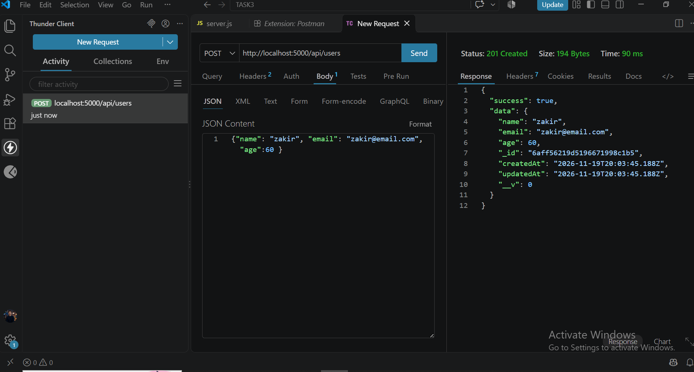
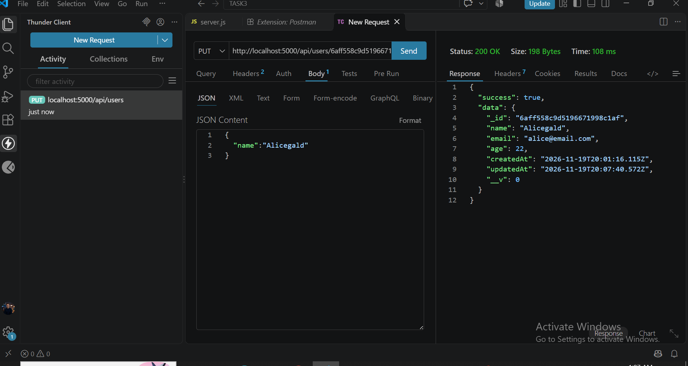

# DecodeLabs Project 3: Database Integration

**Batch:** 2026 | **Track:** Full Stack Development (Persistence Phase)

## 📌 Project Overview
This project fulfills the requirements for Project 3: Database Integration. The goal was to bridge the gap between application logic and permanent storage by designing a database schema, performing CRUD operations, and ensuring strict data integrity. 

The backend is built using **Node.js**, **Express**, and **MongoDB** (integrated via **Mongoose ORM**).

## 🛠️ Tech Stack
*   **Runtime Environment:** Node.js
*   **Web Framework:** Express.js
*   **Database:** MongoDB
*   **ORM / Bridge:** Mongoose
*   **API Testing:** Thunder Client

## 📐 Database Schema & Constraints (Pillar 1 & 4)
The application features a `User` schema designed to enforce data integrity at the database level, preventing bad data from entering the vault. 

*   **`name`**: `String`, **NOT NULL** (Required)
*   **`email`**: `String`, **NOT NULL** (Required), **UNIQUE** (Prevents duplicate accounts)
*   **`age`**: `Number`, **CHECK** (Enforces a minimum age of 18)

## 🔄 CRUD Operations & RESTful Mapping (Pillar 3)
The API maps fundamental database operations to standard HTTP methods:

| Operation | HTTP Method | Endpoint | Description |
| :--- | :--- | :--- | :--- |
| **Create** | `POST` | `/api/users` | Adds a new user to the database. |
| **Read** | `GET` | `/api/users` | Retrieves a list of all users. |
| **Update** | `PUT` | `/api/users/:id` | Modifies existing user data by ID. |
| **Delete** | `DELETE` | `/api/users/:id` | Removes a user from the database by ID. |

---

## 📸 Proof of Concept (API Testing)

### 1. CREATE Operation (POST)
*Sending a POST request to create a new user. The database successfully validates the data and returns the newly created user with a unique `_id`.*



### 2. UPDATE Operation (PUT)
*Sending a PUT request using the user's `_id` to update the name field. The `updatedAt` timestamp automatically reflects the change.*



---

## 🚀 How to Run Locally

1. **Clone the repository:**
   ```bash
   git clone <your-repo-link>
   cd decode-labs-project3

## install dependency
npm install


## set up enviromental variables
PORT=5000
MONGO_URI=your_mongodb_connection_string_here

## start the server
npm run dev

## test the API
Use Postman or Thunder Client to hit http://localhost:5000/api/users.

